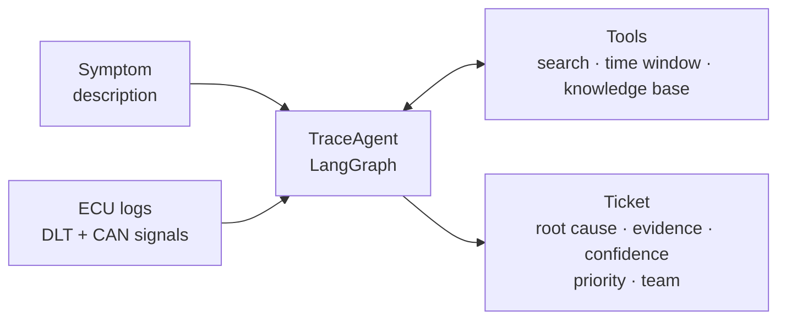
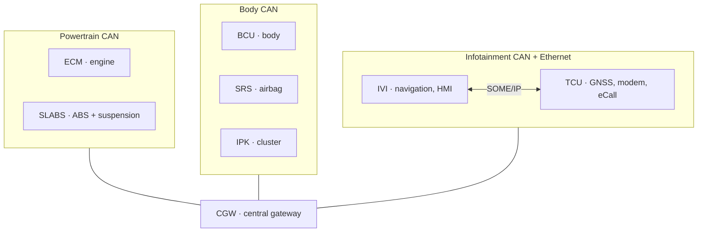

<div align="center">

# TraceAgent

**An AI agent that reads ECU logs, finds the root cause of a vehicle fault and routes the ticket to the right team.**


</div>

---

> *"The navigation loses the car every time it enters a tunnel."*
>
> The error shows up in the infotainment logs. The navigation team gets the ticket.
> The real cause is a frozen rear wheel speed sensor in the ABS — three ECUs and two buses away.

In modern vehicles a fault rarely appears where it originates. It propagates across ECUs, buses and gateways, and the component that complains is often not the one that failed. Triaging these faults means reading thousands of log lines from several ECUs, reconstructing the causal chain and deciding which team owns the fix. Misrouted tickets bounce between teams for days.

**TraceAgent automates that triage.** Given the logs of every ECU and a short symptom description, it investigates like an integration engineer would: it searches the logs, narrows down time windows, checks a knowledge base of error codes, and produces a ticket with the root cause, the evidence that supports it and the responsible team. When the evidence is not conclusive, it says so — and still proposes the most likely teams instead of guessing.

## How it works



The agent never sees the answer. Every test case comes from a **vehicle simulator** that injects one known fault and lets the ECUs react on their own, so the symptoms emerge from the simulated behaviour rather than being written by hand. Because the injected fault is known, every diagnosis can be scored objectively.

## The simulated vehicle

A Land Rover Discovery 2 Td5 — the author's own car — reimagined with a modern E/E architecture: its original ECUs on three domain buses, a central gateway, and a telematics and infotainment unit that write DLT logs.



8 ECUs · 8 owning teams · 20+ signals · 2 log formats. All data is synthetic and every ECU name is generic. The full reasoning behind each architecture decision is in [`docs/design.md`](docs/design.md).

## What a ticket looks like

*Target output format (illustrative):*

```json
{
  "root_cause": "Rear-left wheel speed sensor frozen; VehicleSpeed computed from stale value",
  "evidence": [
    "CAN  t=41.20s  WheelSpeed_RL constant at 52.0 km/h while FL/FR/RR decrease",
    "DLT  t=43.85s  IVI NAVI POS WARN  Vehicle speed / GNSS speed mismatch > 15 km/h"
  ],
  "confidence": 0.86,
  "priority": "high",
  "team": "Chassis",
  "alternative_teams": ["Infotainment", "E/E Architecture"]
}
```

## Evaluation

Each version of the agent runs against the same fixed, seeded set of fault cases.

| Metric | What it measures | v1 target | Result |
|---|---|---|---|
| Root cause accuracy | Correct injected fault identified | 80 % | — |
| Team accuracy | Ticket routed to the owning team | 80 % | — |
| Top-3 team accuracy | Owning team among the three proposed | — | — |
| Correct abstention rate | "Not sure" only when evidence is insufficient | — | — |
| Cost per diagnosis | LLM cost per case | — | — |
| Latency | Time per diagnosis | — | — |

Results will be published here as soon as the first evaluation run is complete.

## Roadmap

- [x] System contract and vehicle architecture ([design doc](docs/design.md))
- [ ] Vehicle simulator with fault injection
- [ ] 10 fault types with noise and red herrings
- [ ] Knowledge base of error codes
- [ ] Agent tools and LangGraph agent
- [ ] Evaluation harness and first results
- [ ] API (FastAPI), Docker, CI and tracing

## Design principles

- **Simulate causes, not symptoms.** Faults are injected as behaviour changes; symptoms emerge from how the ECUs react.
- **Evidence or it didn't happen.** Every diagnosis must cite the log lines that support it.
- **Measured, not demoed.** Every change to the agent is judged against the same evaluation set.
- **Saying "I don't know" is a feature.** A wrong ticket costs more than an honest abstention.

## About

Built by [Eric Serret Llopis](https://www.linkedin.com/in/eric-serret-llopis-5a6324273), automotive engineer with an MSc in Artificial Intelligence. I spend my working days capturing ECU traces, debugging and routing faults across international teams; TraceAgent is the tool I wish I had.

## License

[MIT](LICENSE)
