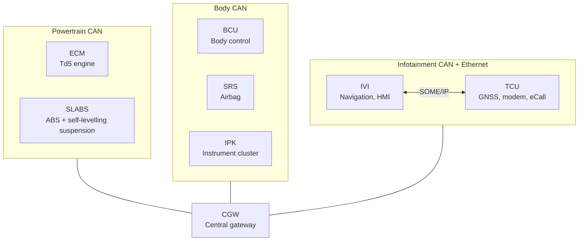

# TraceAgent — Design

> Living design document. Each phase is closed before the next one starts.

## 1. System contract

**Problem.** TraceAgent is an AI agent that helps integration and test engineers triage vehicle faults: it analyses logs from several ECUs, identifies the root cause and routes the ticket to the responsible team.

**Input.**
- One log file per ECU (DLT for ECUs with an operating system, decoded CAN signals for the rest).
- A free-text description of the symptom.
- Context: whether the fault is reproducible or intermittent.
- Optional: timestamp of the incident.

**Output: a ticket with**
- Root cause
- Evidence: the specific log lines / signal samples that justify the diagnosis
- Confidence level
- Priority
- Target team

**What "correct" means.**
- Root cause accuracy and target team accuracy are measured separately. Target for v1: 80 %.
- Abstaining ("I don't know") is better than hallucinating, but the agent must still propose the most likely teams. This adds two metrics: top-3 team accuracy and correct abstention rate.

**Out of scope (v1).**
- Fixing the fault: the agent diagnoses and routes, it does not repair.
- Multiple simultaneous faults: exactly one injected fault per case.
- Real vehicle data or real-time streaming: synthetic logs, processed in batch.

## 2. Simulated world

### 2.1 Vehicle

A "modernised" Land Rover Discovery 2 Td5: the original ECUs of the Td5, placed on a modern network, plus a telematics unit and an infotainment unit. ECU names are generic on purpose.

### 2.2 Network topology

**Decision 1 — Three domain buses.** Mirrors real vehicle E/E architectures: bandwidth (fast powertrain/chassis signals do not compete with infotainment traffic), functional safety (an infotainment fault cannot take down ABS) and security. For the agent, *where* a symptom appears says *which path* it travelled. ABS sits on the powertrain bus because it shares fast, critical signals with the engine.

**Decision 2 — Central gateway (CGW).** The TCU is connected to the internet and must never talk directly to the powertrain: all traffic is filtered and routed by the gateway (in line with UNECE R155). It is also the best source of hard cases: a broken routing rule produces symptoms in one domain but not another, and the root cause is in none of the ECUs that complain.
*Rejected alternative:* BCU acting as gateway. Saves one ECU but mixes responsibilities and blurs team assignment.

**Decision 3 — Ethernet between IVI and TCU.** SOME/IP services: the TCU provides `GnssPosition` and `ConnectivityStatus`, the IVI consumes them. Produces realistic DLT errors (service unavailable, subscription lost, no position update) and a fault class CAN does not have: the service fails while the bus is healthy.

### 2.3 ECUs and teams

| ECU | Function | Team | Writes DLT |
|---|---|---|---|
| ECM | Td5 engine management: injection, glow plugs, immobiliser (engine side) | Powertrain | No |
| SLABS | Two modules: ABS (wheel and vehicle speed) and SLS (rear air levelling) | Chassis | No |
| BCU | Doors, central locking, lights, ignition, immobiliser code | Body | No |
| SRS | Crash detection and airbag deployment | Passive Safety | No |
| IPK | Gauges, warning lamps, basic trip computer | Cluster | No |
| CGW | Routing between buses, network management | E/E Architecture | No |
| TCU | GNSS, cellular modem, emergency call (eCall), remote services | Connectivity | Yes |
| IVI | Navigation, display, vehicle information (consumption, range) | Infotainment | Yes |

**Decision 4 — The airbag is connected.** On a crash, the SRS notifies the BCU (unlock doors, hazard lights) and the TCU (trigger eCall, mandatory in the EU for new vehicles since 2018). This creates a three-domain chain.

**DLT applications**
- **TCU:** `GNSS` (position), `MDM` (modem), `ECLL` (eCall), `RSVC` (remote services: sends speed, odometer and status to the backend).
- **IVI:** `NAVI` (navigation; fuses GNSS with vehicle speed for dead reckoning in tunnels), `VINF` (vehicle information), `HMI` (display), `SYS` (boot, restarts, memory).

### 2.4 Signals

Every signal exists because some ECU consumes it: each one is a path a fault can travel along.

| Signal | Sender | Consumers | Period |
|---|---|---|---|
| `EngineSpeed` (rpm) | ECM | IPK, IVI, SLABS | 10 ms |
| `EngineState` (off / crank / run) | ECM | SLABS, IPK, TCU | 100 ms |
| `CoolantTemp` (°C) | ECM | IPK | 1 s |
| `FuelRate` (l/h) | ECM | IVI, IPK | 100 ms |
| `MIL_Req`, `GlowLamp_Req` | ECM | IPK | 100 ms |
| `WheelSpeed_FL/FR/RL/RR` (km/h) | SLABS | ECM | 20 ms |
| `VehicleSpeed` (km/h) | SLABS | ECM, BCU, IPK, IVI, TCU | 20 ms |
| `RideHeight_RL/RR` (mm) | SLABS | IPK | 100 ms |
| `ABS_Lamp_Req`, `SLS_Lamp_Req` | SLABS | IPK | 100 ms |
| `IgnitionState` (KL15) | BCU | all | 100 ms |
| `DoorStatus` | BCU | SLABS, IPK | 100 ms |
| `ImmoCode` | BCU | ECM | on crank |
| `CrashEvent` | SRS | BCU, TCU | event |
| `SRS_Lamp_Req` | SRS | IPK | 100 ms |
| `Odometer` (km) | IPK | TCU, IVI | 1 s |
| `GnssPosition` (SOME/IP) | TCU | IVI | 1 s |
| `ConnectivityStatus` (SOME/IP) | TCU | IVI | event |

Periods follow the usual rule: dynamic signals are fast, thermal signals are slow, discrete states are event-driven.

*Simulator assumption (to verify against the real vehicle):* the SLS only levels with the engine running and all doors closed.

### 2.5 Fault propagation examples

1. **Rear wheel speed sensor frozen (Chassis).** `VehicleSpeed` is wrong, the speedometer misbehaves, and `NAVI` in the IVI logs a mismatch between vehicle speed and GNSS. User symptom: "navigation loses the car in tunnels". Symptom in Infotainment, root cause in Chassis.
2. **Broken routing rule in the gateway (E/E Architecture).** `VehicleSpeed` no longer reaches the infotainment domain, but the cluster (body domain) works. IVI and TCU log timeouts. The decisive clue is the healthy cluster: the fault is not in the sender, it is in the path.
3. **TCU GNSS application restarts (Connectivity).** The IVI logs "position service unavailable". The IVI writes the error, the TCU is the culprit, and the TCU's DLT shows the restart a few seconds earlier.

### 2.6 Open items

- [ ] Review the signal table against real Td5 knowledge.
- [ ] Healthy DLT line examples for TCU and IVI (format: timestamp, ECU, app, context, level, message).
- [ ] Define what determines ticket priority.
